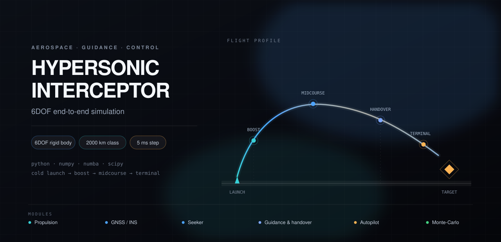

<div align="center">
  
</div>

<h1 align="center">2000 km-class Hypersonic Interceptor</h1>
<h3 align="center">6DOF end-to-end simulation · launch → intercept</h3>

<p align="center">
  <a href="LICENSE"></a>
  
  
  <a href="https://paoshou-china.github.io/missile-interception/"></a>
</p>

<p align="center">
  A modular, testable and parallelizable flight-dynamics simulation of a 2000 km-class
  lifting-body interceptor, written in pure Python / NumPy.<br>
  Vertical cold launch · solid boost + supersonic ramjet · GNSS/INS + radar seeker ·
  Bezier midcourse · ZEM/APN terminal · three-loop autopilot · Monte-Carlo campaigns.
</p>

---

> **Disclaimer** — Public data for a 2000 km-class interceptor are scarce. The geometry,
> mass, inertia, aerodynamic and propulsion parameters in `config.py` are an **engineering
> extrapolation** from public sources plus generic hypersonic-vehicle characteristics.
> They serve algorithm, software and architecture verification only, and do not represent
> measured data or performance of any fielded system.

## Overview

| Area | What is modelled |
| --- | --- |
| **Flight dynamics** | 6DOF rigid body, quaternion attitude, variable mass/inertia, Earth rotation & curvature |
| **Propulsion** | Vertical cold launch, solid booster, supersonic ramjet combined cycle, thrust scheduling |
| **Aerodynamics** | USSA1976 atmosphere, Mach/altitude aerodynamic database, DATCOM cross-check tooling |
| **Navigation** | Strapdown INS, GNSS updates, error-state filtering, wind and sensor noise |
| **Seeker** | Radar seeker measurements, target tracking, measurement latency and dropout |
| **Guidance** | Bezier midcourse, ZEM / APN terminal, multi-constraint handover management |
| **Control** | Three-loop autopilot, fin mixer, actuator limits and rate constraints, gain scheduling |
| **Analysis** | Multi-rate integration, step convergence, Monte-Carlo batch, sensitivity / Sobol |

## Online reports

Interactive reports generated from simulation output, published with GitHub Pages:

| Report | Contents | Link |
| --- | --- | --- |
| **Project overview** | Interactive walk-through: trajectory, energy, handover, key metrics | [Open →](https://paoshou-china.github.io/missile-interception/missile-intercept-overview/missile-intercept-overview.html) |
| **Intercept analysis** | 2000 km-class 6DOF analysis: altitude/Mach profile, LOS rates, miss distance, Monte-Carlo statistics | [Open →](https://paoshou-china.github.io/missile-interception/intercept-report/intercept-report.html) |
| **Full-flow test report** | Subsystem and end-to-end test summary: aero anchors, navigation, seeker, handover, control, numeric consistency | [Open →](https://paoshou-china.github.io/missile-interception/test-report/missile_interceptor_test_report.html) |

## Flight phases

| Phase | Model |
| --- | --- |
| **Cold launch** | Vertical ejection from a canister, ignition sequence, initial attitude hold |
| **Boost** | Solid motor thrust profile, mass depletion, attitude pre-programming |
| **Midcourse** | Bezier path shaping, altitude/Mach constraints, energy management |
| **Handover** | Handover manager with field-of-view, range and geometry constraints |
| **Terminal** | ZEM / APN guidance, seeker measurements, endgame autopilot limits |
| **Assessment** | Miss distance, intercept geometry, Monte-Carlo dispersion statistics |

## Repository layout

```
.
├── missile_intercept/           # simulation package
│   ├── main.py                  # single-run entry point
│   ├── batch.py                 # Monte-Carlo batch campaigns
│   ├── analysis.py              # sensitivity / Sobol / Monte-Carlo analysis
│   ├── config.py                # all engineering parameters and switches
│   ├── fastcore.py              # Numba-JIT hot paths (falls back to pure Python)
│   ├── integrator.py            # multi-rate integration and event handling
│   ├── state_schema.py          # state vector definition
│   ├── telemetry.py             # telemetry writers
│   ├── verification.py          # numerical verification
│   ├── validate_performance.py  # performance checks
│   ├── vehicle/                 # atmosphere, aerodynamics, target, wind
│   ├── sensors/                 # IMU, GNSS/INS, seeker, target tracker
│   ├── guidance/                # boost / midcourse / terminal guidance, handover
│   ├── control/                 # autopilot, fin mixer, thrust controller
│   ├── tools/                   # aero cross-check, tuning, diagnostics
│   ├── tests/                   # pytest suite
│   └── README.md                # full technical reference and telemetry dictionary
├── intercept-report/            # intercept analysis report (HTML)
├── missile-intercept-overview/  # project overview page (HTML)
├── test-report/                 # full-flow test report (HTML)
├── assets/                      # README figures
└── index.html                   # GitHub Pages landing page
```

## Quick start

```bash
git clone https://github.com/PaoShou-China/missile-interception.git
cd missile-interception/missile_intercept
python -m pip install -r requirements.txt
```

```bash
# Single run — 5 ms in boost/terminal, 10 ms in midcourse
python main.py

# Variants
python main.py --no-plot          # telemetry CSV only
python main.py --duration 900     # custom end time
python main.py --converge         # step convergence + Richardson extrapolation

# Monte-Carlo campaign
python batch.py --cases 50 --workers 8 --seed 2026

# Tests and verification
python -m pytest -n auto
python verification.py
```

Outputs are written to `missile_intercept/output/` (telemetry CSV, plots and the HTML
dashboard) and are intentionally not tracked.

> **Requirements** — Python 3.9+ on Windows or Linux. `numba` accelerates the hot paths;
> without it the solver falls back to pure Python with identical results but slower runs.
> The DATCOM binary in `tools/datcom/` is third-party software and is not versioned.

## Documentation

- [Technical reference — architecture, frames, models, telemetry dictionary](missile_intercept/README.md)
- [English edition (legacy)](missile_intercept/README.en.md)
- [Changelog](CHANGELOG.md) · [Contributing](CONTRIBUTING.md) · [Security policy](SECURITY.md)
- [Code of Conduct](CODE_OF_CONDUCT.md)

## Contributing

Issues and pull requests are welcome. Please read [CONTRIBUTING.md](CONTRIBUTING.md) for
branch, commit and testing conventions, and run `python -m pytest -n auto` before opening a PR.

## License

Released under the [MIT License](LICENSE).

---

<p align="center"><sub>Engineering-extrapolated model — for algorithm and software verification only.</sub></p>
