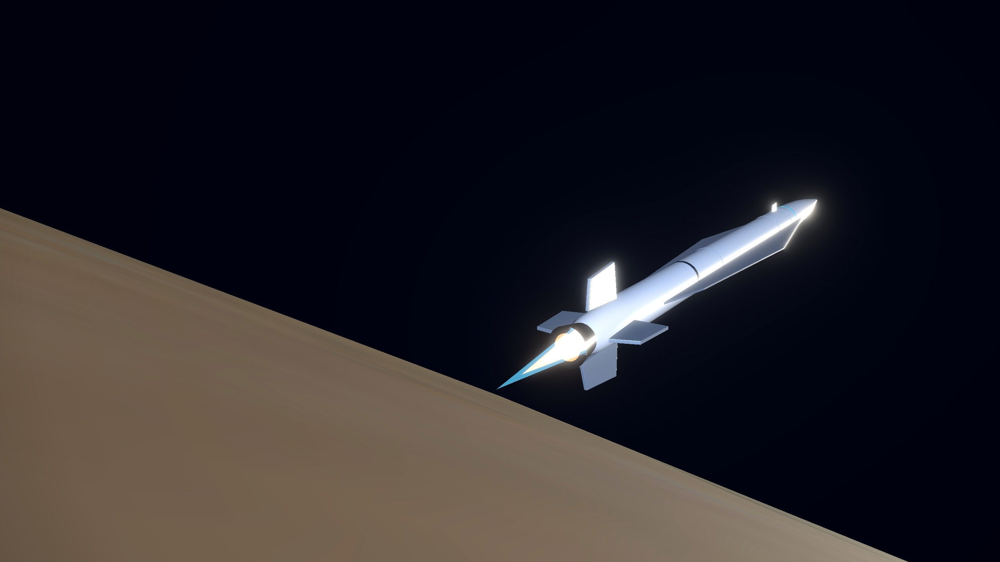
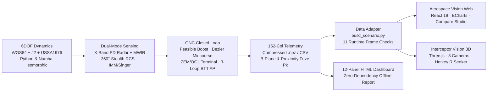

<div align="center">
  
</div>

<p align="center">
  
</p>

<h1 align="center">2000 km-Class Hypersonic Interceptor</h1>
<p align="center">
  <strong>High-Fidelity 6DOF Flight Dynamics · Dual-Mode Radar/IR Seeker · Browser-Native 3D Replay</strong>
</p>

<p align="center">
  <a href="https://paoshou-china.github.io/missile-interception/"></a>
  <a href="TECHNICAL_REPORT.md"></a>
</p>

<p align="center">
  <a href="LICENSE"></a>
  
  
  
  
</p>

<p align="center">
  <a href="#key-metrics">Key Metrics</a> ·
  <a href="#system-architecture">Architecture</a> ·
  <a href="#platform-highlights">Platform Highlights</a> ·
  <a href="#guidance--control-matrix">GNC Matrix</a> ·
  <a href="#quick-start">Quick Start</a> ·
  <a href="#verification-snapshot">Verification</a>
</p>

---

> [!NOTE]
> **Engineering Disclaimer** — Public data for a 2000 km-class hypersonic interceptor are scarce. Geometry, mass, inertia, aerodynamic and propulsion parameters in `missile_intercept/config.py` are an **engineering extrapolation** from public literature and generic hypersonic-vehicle characteristics. They serve algorithm, software, and visualization architecture verification only, and do not represent measured data or any fielded system.

## Key Metrics

<table align="center">
  <tr>
    <td align="center" width="25%">
      <h3>1.48 m</h3>
      <sub>Nominal 6DOF Miss Distance<br/><code>@ 680.47 s · Pk(fuze) = 99.5%</code></sub>
    </td>
    <td align="center" width="25%">
      <h3>93.8%</h3>
      <sub>48-Case Envelope Matrix<br/><code>45/48 Hit (≤15 m) · 6/6 Suites PASS</code></sub>
    </td>
    <td align="center" width="25%">
      <h3>Ma 9.48</h3>
      <sub>Peak Hypersonic Speed<br/><code>Sutton-Graves 8.60 MW/m² · 2540 K</code></sub>
    </td>
    <td align="center" width="25%">
      <h3>205+</h3>
      <sub>Automated Checks Passing<br/><code>103 Python · 36 Root · 66 Web · 40 3D</code></sub>
    </td>
  </tr>
</table>

## System Architecture



## Platform Highlights

| Module | What It Delivers |
| --- | --- |
| **`missile_intercept/`** | Modular 14-state 6DOF simulator (`Python + Numba fastcore`) covering cold launch → boost → midcourse → handover → terminal intercept, dual-mode X-band/MWIR seeker, Sutton-Graves aerothermal model, proximity-fuze warhead lethality, and Monte-Carlo campaigns. |
| **`aerospace-vision-web/`** | Academic portal & **Comparison Studio** (`React 19 + Vite + ECharts`): real validated telemetry only, 2× HD PNG chart export, 48-case envelope matrix, Presenter Mode for projector demos, and 30-second Guided Tour. |
| **`interceptor-vision/`** | Dedicated **Three.js + Blender** 3D explorer (`#/explore`): 8 camera presets, real fin deflections & plume, WGS84/USSA1976 browser 6DOF, and real-time **Dual-Mode Radar/IR Seeker Overlay** (press `R`). |
| **`intercept_dashboard.html`** | Zero-dependency, bilingual 12-panel standalone HTML dashboard with interactive terminal timeline, B-Scope/R-D radar, Ironbow/White-Hot MWIR, 360° RCS polar, aerothermal curves, and B-Plane kill box. |

## Guidance & Control Matrix

Switchable laws implemented in the simulator and paired in the web **Comparison Studio** (`#/compare`):

| Stage | Implemented Laws | Source |
| --- | --- | --- |
| **Boost** | Feasibility-shaped gravity turn · Classical fixed-rate programme | `guidance/boost_guidance.py`, `guidance/fixed_rate_boost_guidance.py` |
| **Midcourse** | Cubic Bezier shaping · Predicted-intercept-point (PIP) direct | `guidance/midcourse_guidance.py`, `guidance/pip_midcourse_guidance.py` |
| **Terminal** | Singer-OGL / ZEM-APN · Classical pure PN | `guidance/terminal_guidance.py`, `guidance/pure_pn_guidance.py` |
| **Autopilot** | 3-axis scheduled BTT three-loop · Uncompensated · No-$n_z$ · Classical fixed-gain PID | `control/autopilot.py`, `control/classic_autopilot.py` |
| **Sensors & Aero** | 360° VLO stealth RCS, X-band PD radar (Doppler notch), MWIR imaging, Sutton-Graves heating | `sensors/seeker.py`, `vehicle/missile.py`, `vehicle/warhead.py` |

## Repository Layout

```text
.
├── missile_intercept/            # Python + Numba 6DOF simulator
│   ├── main.py                   # Single run (--boost/--midcourse/--terminal/--control-law)
│   ├── batch.py                  # Parallel Monte-Carlo campaigns (paired case_id)
│   ├── fastcore.py               # Numba JIT kernel (100% isomorphic with Python path)
│   ├── guidance/                 # Boost, Bezier/PIP midcourse, ZEM/OGL/PN terminal, handover
│   ├── control/                  # Scheduled 3-loop BTT autopilot, classic PID, fin mixer, thrust
│   ├── sensors/                  # IMU, strapdown GNSS/INS, dual-mode seeker, target tracker
│   ├── vehicle/                  # WGS84/USSA1976, DATCOM+Newton aero, aerothermal, warhead, target
│   └── visualization.py          # 12-panel bilingual standalone HTML dashboard generator
├── aerospace-vision-web/         # Academic portal, Results, Verification & Comparison Studio
├── interceptor-vision/           # Three.js + Blender 3D Explorer & real-time Seeker Overlay
├── docs/experiments/             # Paired Monte-Carlo campaigns & reports
├── assets/                       # Hero render & brand icon
└── TECHNICAL_REPORT.md           # Full Chinese technical report (equations, data, audit)
```

## Quick Start

### 1. Run 6DOF Simulation & Verification (Python 3.9+)

```bash
cd missile_intercept
python -m pip install -r requirements.txt

# Nominal 6DOF run (outputs 152-col .npz telemetry + 12-panel HTML dashboard)
python main.py

# Compare guidance / autopilot laws
python main.py --boost-law fixed_rate --control-law classic_pid --no-plot
python main.py --midcourse-law pip_pn --terminal-law pn --no-plot

# Full 48-case performance envelope matrix
python validate_performance.py --workers 12

# Paired Monte-Carlo campaign
python batch.py --cases 24 --workers 8 --seed 2026
```

### 2. Run Web Platform & 3D Explorer (Node 20+)

```bash
cd aerospace-vision-web
npm ci
npm run dev        # http://localhost:5173
npm test           # Vitest: 66 unit & scientific tests
npm run build      # Production bundle in dist/
```

<details>
<summary><strong>Data Adapter & Scenario Regeneration Commands</strong></summary>

```bash
# Regenerate aerospace-vision-web scenario.json from latest telemetry
cd aerospace-vision-web
python tools/data-adapter/build_scenario.py

# Export a paired campaign case for Comparison Studio
cd ../missile_intercept
python tools/export_campaign_case.py --law bezier_zem_apn --out output/experiments/example
```

</details>

## Verification Snapshot

| Verification Area | Status & Key Result |
| --- | --- |
| Backend 6DOF & Python/Numba isomorphism (`missile_intercept`, `pytest`) | **103 / 103 PASS** |
| Root provenance & traceability (`tests/`, `pytest`) | **36 / 36 PASS** |
| 48-case full-envelope matrix (`validate_performance.py`, 12 workers) | **6 / 6 Suites PASS (45/48 = 93.8%)** |
| Nominal 6DOF intercept (`main.py`, 152-col `.npz`) | **1.48 m** miss @ 680.47 s (`Pk(fuze) = 99.5%`) |
| Scenario data contract (`verify_scenario.py`) | **11 / 11 PASS** (float64 quaternion err `6.19e-12`) |
| Web unit & scientific tests (`aerospace-vision-web`, Vitest) | **66 / 66 PASS** + production build PASS |
| 3D explorer validators (`interceptor-vision`) | **28 / 28 Aero**, **12 / 12 6-DoF** + build PASS |
| Browser E2E & narrow screen | 16 PASS, 60.2 FPS (Intel UHD); 390×844 verified |

> [!TIP]
> See [VALIDATION_STATUS.md](aerospace-vision-web/docs/scientific/VALIDATION_STATUS.md) and [COMPARISON.md](aerospace-vision-web/docs/COMPARISON.md) for the exact scope, matching contracts, and NOT RUN items.

<details>
<summary><strong>Scientific Conventions (WGS84 / ECEF / Quaternions)</strong></summary>

| Quantity | Convention |
| --- | --- |
| Render frame | WGS84 ECEF, right-handed, kilometres in renderer |
| Source frame | ECI; `ECI == ECEF` at `t = 0`; `r_ECEF = Rz(−ωt) r_ECI` |
| Attitude | Scalar-first `[w, x, y, z]`, Hamilton product, `BODY → ECEF` |
| Body axes | `+x` nose, `+y` right, `+z` down |
| Interpolation | Cubic Hermite (position) · shortest-arc SLERP (attitude) |
| Displayed speed | Earth-relative `|v_ECEF|`; Mach is wind-corrected |

</details>

## Documentation

- [Technical Report (中文完整技术总结报告)](TECHNICAL_REPORT.md)
- [Simulation Reference (中文)](missile_intercept/README.md) · [English Edition](missile_intercept/README.en.md)
- [Web Architecture](aerospace-vision-web/docs/ARCHITECTURE.md) · [Comparison Policy](aerospace-vision-web/docs/COMPARISON.md) · [Acceptance Log](aerospace-vision-web/docs/ACCEPTANCE.md)
- [Data Audit](aerospace-vision-web/docs/scientific/DATA_AUDIT.md) · [Provenance](aerospace-vision-web/docs/scientific/RESULT_PROVENANCE.md) · [Validation Status](aerospace-vision-web/docs/scientific/VALIDATION_STATUS.md)
- [Changelog](CHANGELOG.md) · [Contributing](CONTRIBUTING.md) · [Security](SECURITY.md) · [License (MIT)](LICENSE)

---

<p align="center">
  <sub>Built for 6DOF flight-dynamics verification & scientific visualization · Engineering-extrapolated model only.</sub>
</p>
