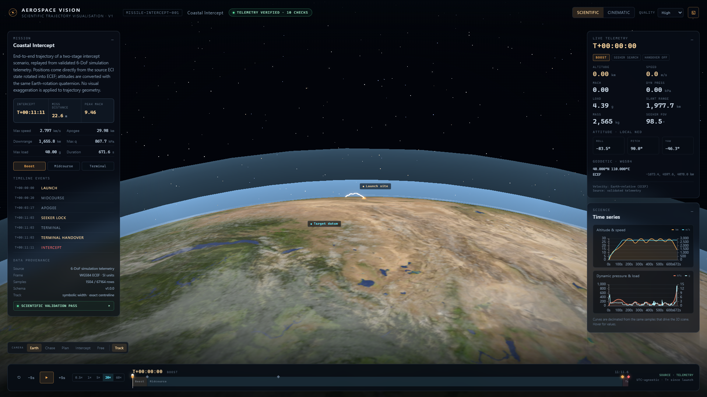
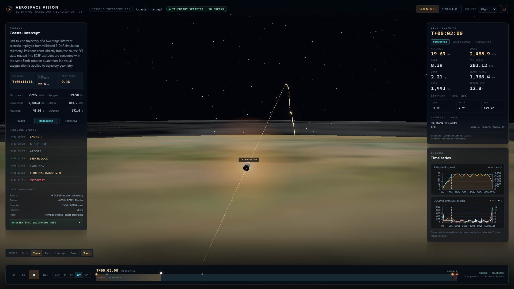
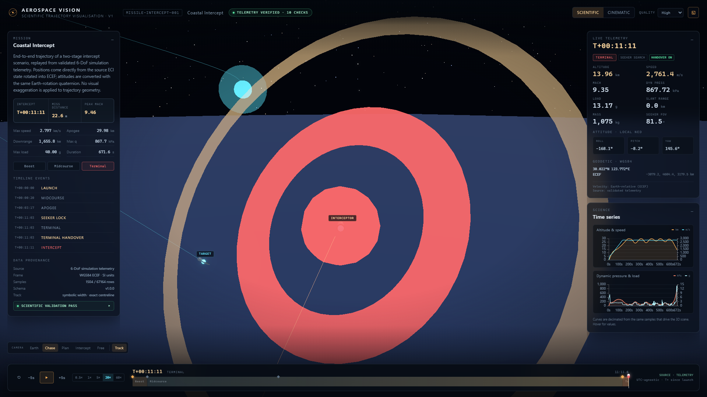
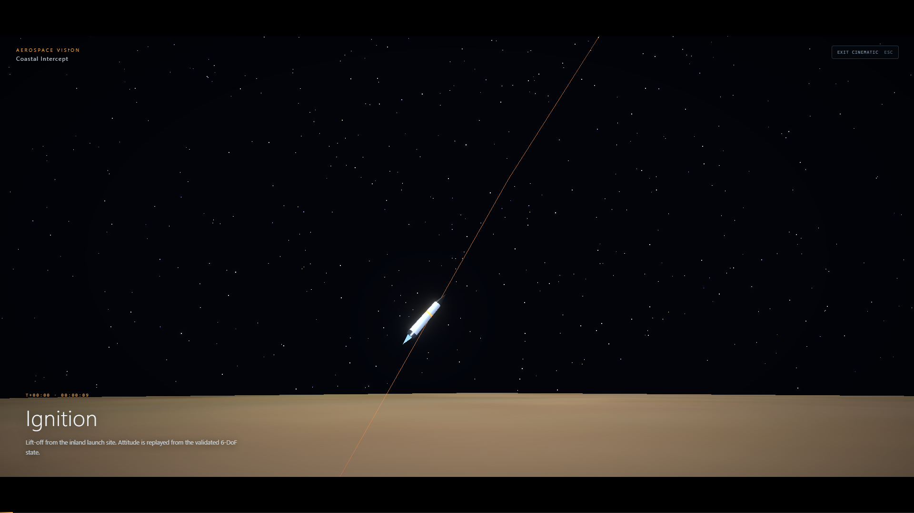
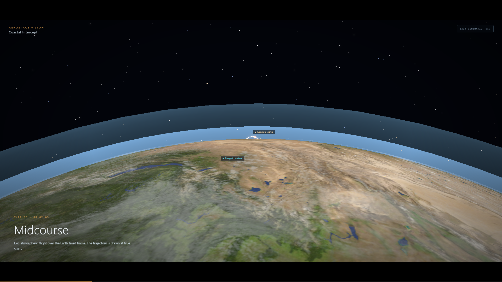

# Aerospace Vision Web

A browser-native, scientifically grounded 3D visualisation platform for aerospace
trajectories. It replays validated 6-DoF simulation telemetry on a WGS84 Earth in
the Earth-fixed (ECEF) frame, with true-scale geometry, a shared simulation clock,
live telemetry, synchronised charts, free/chase/orbital cameras, and a captioned
cinematic presentation.

The first scenario, **Coastal Intercept**, is generated from the telemetry of
[`PaoShou-China/missile-interception`](https://github.com/PaoShou-China/missile-interception):
67,164 telemetry rows → 1,504 validated samples, 671.63 s of flight, 1,655.8 km
of downrange, 29.98 km apogee, 22.61 m closest approach.

No backend, no Unreal/Unity, no plugins: a static Vite build served from GitHub
Pages is enough.

**Live:** https://paoshou-china.github.io/missile-interception/
· legacy report: https://paoshou-china.github.io/missile-interception/legacy/

**Status:** G0–G5 **PASS**. 1080p soak on an Intel UHD GPU: mean **60.0 FPS**,
min 51.0, JS heap 41.3 → 41.3 MB over 10 minutes of continuous replay. E2E:
**16 passed / 2 skipped** across Chromium, Firefox and WebKit (the FPS gate runs
on Chromium only). Remaining gaps are mobile devices, tiled Earth LOD and
Firefox/WebKit performance profiling. See
[docs/ACCEPTANCE.md](docs/ACCEPTANCE.md) and
[docs/performance/soak-1080p.md](docs/performance/soak-1080p.md).

| Overview | Chase |
| --- | --- |
|  |  |

| Intercept | Cinematic |
| --- | --- |
|  |  |

| Midcourse |
| --- |
|  |

## Quick start

```bash
cd aerospace-vision-web
npm ci
npm run dev          # http://localhost:5173
npm test             # 39 unit / scientific tests
npm run build        # production bundle in dist/
npm run preview      # serve dist/ locally
npm run perf:soak    # 10-minute 1080p FPS + memory soak (preview server on :4173)
```

The committed scenario payload (`public/data/missile-intercept/scenario.json`) is
enough to run the site. To regenerate it from the simulator telemetry:

```bash
python tools/data-adapter/build_scenario.py
```

The adapter reads `../missile_intercept/output/telemetry.csv` (produced by the
source simulator). It validates every conversion and exits non-zero if any check
fails.

## Architecture

```
telemetry.csv ──► tools/data-adapter/build_scenario.py ──► scenario.json
                   (frames, units, checks, provenance)          │
                                                                ▼
   ┌──────────────────────────── src/ ─────────────────────────────────────┐
   │ scientific/  types · geodesy · quaternion · interpolate · clock       │
   │              attitude · scenario (load + validate)                    │
   │ state/       single SimulationClock + throttled Zustand mirror        │
   │ scene/       Earth · atmosphere · stars · sun · vehicle · trajectory  │
   │              camera rig (earth / chase / plan / intercept / free)     │
   │ components/  mission, telemetry, charts (ECharts), timeline, HUD      │
   │ cinematic/   shot list + captions + letterbox overlay                 │
   └───────────────────────────────────────────────────────────────────────┘
```

- **One clock.** `SimulationClock` is advanced once per animation frame by a
  driver inside the R3F canvas. The 3D scene reads it directly; React state is a
  throttled mirror (20 Hz) for text and charts. Models, trajectory, camera,
  HUD, and charts can never drift apart.
- **One data path.** All motion comes from the sample arrays; no procedural or
  random animation is used for pose. The only derived quantity is the target's
  orientation (its telemetry has position/velocity, not attitude), computed from
  the ECEF velocity and labelled as derived.
- **Frozen contract.** `schemas/scenario-manifest.schema.json` and
  `src/scientific/types.ts` define `ScenarioManifest`, `TrajectorySample`,
  `SceneEntity`, `PlaybackState` (clock), `CameraMode`, `ScientificObservable`,
  and `VisualizationEvent`.

Details: [docs/ARCHITECTURE.md](docs/ARCHITECTURE.md) ·
Science: [docs/SCIENTIFIC_NOTES.md](docs/SCIENTIFIC_NOTES.md).

## Scientific conventions

| Quantity | Convention |
| --- | --- |
| Render frame | WGS84 ECEF, right-handed, kilometres in the renderer |
| Source frame | ECI; `ECI == ECEF` at t = 0; `r_ECEF = Rz(−ωt) r_ECI` |
| Attitude | scalar-first `[w,x,y,z]`, Hamilton product, `BODY → ECEF` |
| Body axes | +x nose, +y right, +z down |
| Time | seconds since launch, monotonic; one shared clock |
| Position interpolation | cubic Hermite with telemetry velocity tangents |
| Attitude interpolation | shortest-arc SLERP, renormalised |
| Speed shown | Earth-relative `|v_ECEF|` (verified; Mach is wind-corrected) |

No altitude or trajectory exaggeration is applied. The vehicle mesh is built at
its physical ~6.5 m length; a distance-scaled glow marker keeps it findable at
orbital zoom without moving it.

## Validation

```
$ python tools/data-adapter/build_scenario.py
checks  : PASS
  [PASS] timeline-monotonic     dt_min=0.01 s, dt_max=0.01 s
  [PASS] finite-values          rows=67164, columns=132
  [PASS] eci-ecef-alignment     |r_eci - r_ecef| at t=0 = 0.000e+00 m
  [PASS] velocity-frame         at t=335.8 s, frame error = 6.829e-07 m/s
  [PASS] llh-ecef-roundtrip     max ||LLH->ECEF - r_ECEF|| = 0.073 m
  [PASS] quaternion-normalized  max |‖q‖-1| = 8.176e-07 (6-decimal CSV)
  [PASS] speed-semantics        source m_speed is inertial |v_ECI|
  [PASS] speed-and-mach-semantics  airspeed = |v_ECEF|; Mach is wind-corrected
  [PASS] altitude-units         WGS84 geodetic height, 0 … 29 980.7 m
  [PASS] sample-recovery        lat err ≤ 0.06 m, alt err ≤ 0.00 m
```

The browser re-validates the payload on load (monotonic time, finite values,
unit quaternions, ECEF ↔ geodetic agreement < 1 m) and refuses to render if it
fails. Tests cover geodesy, quaternion algebra, interpolation, the clock, the
attitude frame conversion, and the scenario itself.

## Features

- Scientific and Cinematic modes; cinematic auto-tour with wall-time paced
  shots (6–22 s per caption) and a hard cut into the launch framing.
- Timeline with phase bands, event markers, play/pause, 0.5×–60× speed, ±5 s
  stepping, reset, click/drag scrubbing, keyboard control.
- Cameras: Earth overview, chase, launch, plan, intercept framing, free orbit.
- Live telemetry with units, phase, seeker state, NED roll/pitch/yaw, WGS84
  coordinates, ECEF vector, and provenance.
- ECharts time series for altitude/speed and dynamic pressure/load, with a
  moving time cursor.
- 8K Earth day map + 4K clouds + moderate HDR bloom on High; automatic 2K
  fallback on GPUs with a texture-size limit below 8192.
- Track emphasis toggle: symbolic orbital cord on/off with an exact-centreline
  disclosure; true-scale polyline always available.
- Quality levels (DPR, star count, Earth tessellation, bloom), resource
  disposal, no per-frame React churn.

## Deployment

`.github/workflows/aerospace-vision-pages.yml` builds and publishes the site to
GitHub Pages from the `aerospace-vision-web/` subdirectory. Enable **Pages →
GitHub Actions** in the repository settings. The build uses a relative base, so
it works under a project path such as `/<repo>/` without configuration.

The published site root is this platform. The previous static report is staged
into `/legacy/` during deployment and remains accessible at
`/<repo>/legacy/`.

## Assets and licensing

- Earth day texture: NASA Blue Marble via the three.js examples assets
  (`examples/textures/planets/earth_atmos_2048.jpg`), public domain imagery.
- Vehicle meshes: procedural geometry authored in this project.
- Scenario data: derived from the MIT-licensed source repository; provenance
  and SHA-256 of the telemetry file are embedded in the manifest.
