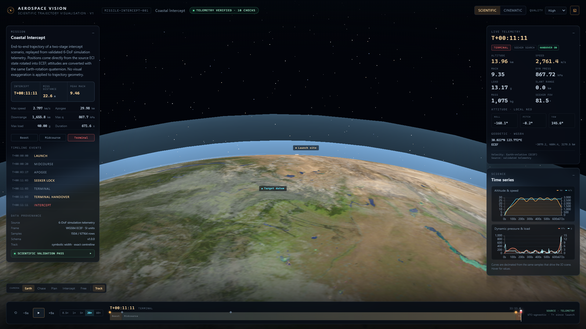

# 1080p soak test

- Date: 2026-11-20T14:03:11.156Z
- URL: http://127.0.0.1:4173/?qa=1
- Renderer: ANGLE (Intel, Intel(R) UHD Graphics (0x0000A788) Direct3D11 vs_5_0 ps_5_0, D3D11)
- Viewport: 1920×1080, quality high (8K Earth + bloom)
- Duration: 10 min continuous replay
- Initial load: 0.29 s
- Mean FPS: **60.0**
- Min / P95 FPS: 51.0 / 60.2
- JS heap: 41.3 → 41.3 MB (Δ -0.1 MB)
- Console errors: none

