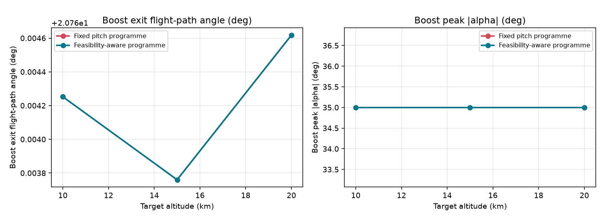

# 制导与控制算法对比实验报告

本报告由 `tools/guidance_comparison.py` 自动生成，全部数据来自 6DOF 端到端仿真，未经手工修改。

## 1. 实验设计

四个实验均采用**配对蒙特卡洛**：同一 `case_id` 在两种算法下使用完全相同的发射点/目标点散布、高度/马赫散布、导航与导引头随机种子以及目标机动相位，因此同一 case 的差异只来自被测环节的算法。每次只替换一个环节，其余三个环节固定为参考算法。

| 实验 | 被测环节 | 对比算法 | 固定配置 | 扫描参数 | 每档样本 |
| --- | --- | --- | --- | --- | --- |
| 助推段制导 | 助推段制导 | 常值俯仰速率程序 vs 升力可行域自适应程序 | 固定：Bezier 中制导 + ZEM/APN 末制导 + 调度三回路 | 目标高度 (km) 10, 15, 20 | 24 |

公共设置：基础随机种子 2026，命中判据为脱靶量 ≤ 15.0 m；发射点水平 CEP 500 m、目标水平 CEP 2000 m、目标高度 σ 500 m、目标马赫 σ 0.05；弹体、导航/导引头、交接逻辑与未被测环节全部相同。

## 2. 助推段制导对比结果

### 统计汇总

| 目标高度 (km) | 算法 | 有效样本 | 命中率 | 中位脱靶 (m) | P90 脱靶 (m) | 最大脱靶 (m) | 交接率 | 交接距离 (km) |
| --- | --- | --- | --- | --- | --- | --- | --- | --- |
| 10 | 常值俯仰速率程序 | 24 | 37.5% | 15.9 | 31.7 | 36 | 100 | 23.4 |
| 10 | 升力可行域自适应程序 | 24 | 37.5% | 15.9 | 31.7 | 36 | 100 | 23.4 |
| 15 | 常值俯仰速率程序 | 24 | 70.8% | 12.3 | 18.2 | 24 | 100 | 23.3 |
| 15 | 升力可行域自适应程序 | 24 | 70.8% | 12.3 | 18.2 | 24 | 100 | 23.3 |
| 20 | 常值俯仰速率程序 | 24 | 79.2% | 8.7 | 32.5 | 992 | 100 | 23.3 |
| 20 | 升力可行域自适应程序 | 24 | 79.2% | 8.7 | 32.5 | 992 | 100 | 23.3 |

### 全阶段指标（各扫描档平均）

| 目标高度 (km) | 算法 | 助推退出马赫 | 助推退出高度 (km) | 中制导峰值马赫 | 交接比能量 (MJ/kg) | 末制导峰值指令 (g) | 末制导峰值过载 (g) | 末制导舵面饱和 (%) | 交接方位角 (°) |
| --- | --- | --- | --- | --- | --- | --- | --- | --- | --- |
| 10 | 常值俯仰速率程序 | 2.15 | 6.3 | 9.44 | 4.52 | 40.0 | 19.2 | 6.6 | 8.20 |
| 10 | 升力可行域自适应程序 | 2.15 | 6.3 | 9.44 | 4.52 | 40.0 | 19.2 | 6.6 | 8.20 |
| 15 | 常值俯仰速率程序 | 2.15 | 6.3 | 9.44 | 4.81 | 40.0 | 14.6 | 15.5 | 5.60 |
| 15 | 升力可行域自适应程序 | 2.15 | 6.3 | 9.44 | 4.81 | 40.0 | 14.6 | 15.5 | 5.60 |
| 20 | 常值俯仰速率程序 | 2.15 | 6.3 | 9.41 | 4.87 | 40.0 | 11.1 | 66.4 | 5.86 |
| 20 | 升力可行域自适应程序 | 2.15 | 6.3 | 9.41 | 4.87 | 40.0 | 11.1 | 66.4 | 5.86 |

### 配对显著性检验（Wilcoxon 符号秩 + Bootstrap 中位数差 95% CI）

| 目标高度 (km) | 对比 | 配对数 | 中位差 (m) | 95% CI | p 值 | 结论 |
| --- | --- | --- | --- | --- | --- | --- |
| 10 | 常值俯仰速率程序 - 升力可行域自适应程序 | 24 | 0.0 | [0.0, 0.0] | — | 未见显著差异 |
| 15 | 常值俯仰速率程序 - 升力可行域自适应程序 | 24 | 0.0 | [0.0, 0.0] | — | 未见显著差异 |
| 20 | 常值俯仰速率程序 - 升力可行域自适应程序 | 24 | 0.0 | [0.0, 0.0] | — | 未见显著差异 |

## 3. 结论

- **助推段制导**：常值俯仰速率程序 平均命中率 62.5%，升力可行域自适应程序 为 62.5%；平均中位脱靶量 12.3 m 与 12.3 m。配对中位差（常值俯仰速率程序 − 升力可行域自适应程序）范围 0.0 ~ 0.0 m，正值为前者脱靶量更大；在 0/3 个扫描档上配对差异达到 p < 0.05。助推退出航迹角 20.76 / 20.76°，助推段峰值攻角 35.00 / 35.00°。
- 四个实验中的“差异显著”仅表示在该模型、该样本量与配对设计下统计可分辨，不构成对其他弹体/传感器配置的外推结论。

## 4. 方法与可复现性

- 仿真：6DOF 刚体 + 四元数姿态，RK4 变步长积分，制导 5 ms / 控制 5 ms / 导引头与导航按各自周期零阶保持。
- 对比公平性：未被测环节完全固定；同一实验内两种算法共享同一时间对齐、导引头几何、重力补偿、FOV 保护、指令平滑与过载限幅管线。
- 控制对比说明：两种自动驾驶仪共用同一参考调节器、时延预测、内外环增益基准值、抗积分饱和与舵面限幅；差异仅为增益调度与法向过载环。
- 统计：命中率为脱靶量 ≤ 15.0 m 的比例；配对检验对同一 case 的脱靶量做 Wilcoxon 符号秩检验，Bootstrap（2000 次）给出中位数差 95% 置信区间。
- 复现命令：`python tools/guidance_comparison.py --cases 24 --seed 2026`

## 5. 适用边界

弹体几何、质量/惯量与气动/推进参数为公开资料的工程外推（见仓库 README 免责声明），实验结论只对该模型成立，不代表任何实装系统性能。

## 图表

