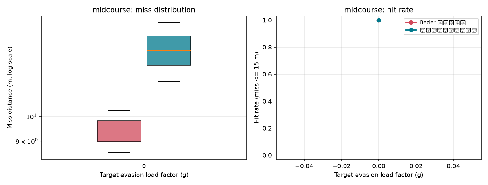
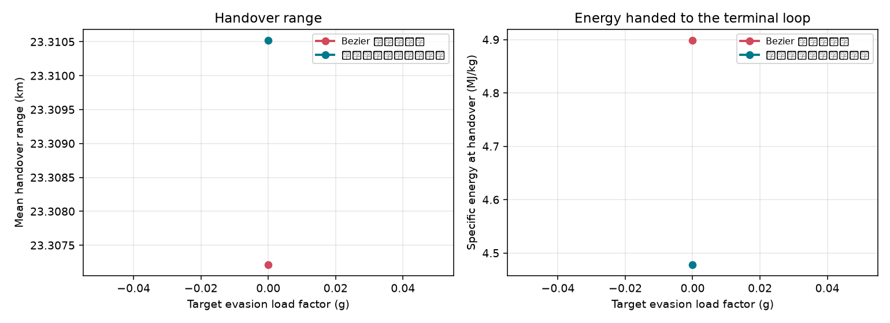

# 制导算法对比实验报告

本报告由 `tools/guidance_comparison.py` 自动生成，全部数据来自 6DOF 端到端仿真，未经手工修改。

## 1. 实验设计

两套实验均采用**配对蒙特卡洛**：同一 `case_id` 在两种算法下使用完全相同的发射点/目标点散布、高度/马赫散布、导航与导引头随机种子以及目标机动相位，因此同一 case 的差异只来自制导律本身。

| 实验 | 固定环节 | 对比算法 | 扫描参数 | 每档样本 |
| --- | --- | --- | --- | --- |
| 末制导对比 | 中制导 = Bezier 整形 | 经典真比例导引 (PN) vs ZEM/APN | 目标机动过载 0 g | 2 |
| 中制导对比 | 末制导 = ZEM/APN | 预测拦截点直接中制导 vs Bezier 整形 | 目标机动过载 0 g | 2 |

公共设置：基础随机种子 2026，命中判据为脱靶量 ≤ 15.0 m；发射点水平 CEP 500 m、目标水平 CEP 2000 m、目标高度 σ 500 m、目标马赫 σ 0.05；所有算法共用同一套 6DOF 弹体、三回路自动驾驶仪、导航/导引头模型与交接逻辑。

## 2. 末制导对比结果

### 统计汇总

| 机动 (g) | 算法 | 有效样本 | 命中率 | 中位脱靶 (m) | P90 脱靶 (m) | 最大脱靶 (m) | 交接率 | 交接距离 (km) |
| --- | --- | --- | --- | --- | --- | --- | --- | --- |
| 0 | 经典真比例导引 (PN) | 2 | 50.0% | 11.9 | 16.8 | 18 | 100 | 23.3 |
| 0 | ZEM/APN 参考律 | 2 | 100.0% | 9.4 | 10.1 | 10 | 100 | 23.3 |

### 全阶段指标（各机动档平均）

| 机动 (g) | 算法 | 中制导峰值马赫 | 中制导峰值高度 (km) | 交接比能量 (MJ/kg) | 末制导峰值指令 (g) | 交接方位角 (°) |
| --- | --- | --- | --- | --- | --- | --- |
| 0 | 经典真比例导引 (PN) | 9.44 | 30.0 | 4.90 | 40.0 | 6.96 |
| 0 | ZEM/APN 参考律 | 9.44 | 30.0 | 4.90 | 40.0 | 6.96 |

### 配对显著性检验（Wilcoxon 符号秩 + Bootstrap 中位数差 95% CI）

| 机动 (g) | 对比 | 配对数 | 中位差 (m) | 95% CI | p 值 | 结论 |
| --- | --- | --- | --- | --- | --- | --- |
| 0 | 经典真比例导引 (PN) - ZEM/APN 参考律 | 2 | — | [—, —] | — | 未见显著差异 |

## 3. 中制导对比结果

### 统计汇总

| 机动 (g) | 算法 | 有效样本 | 命中率 | 中位脱靶 (m) | P90 脱靶 (m) | 最大脱靶 (m) | 交接率 | 交接距离 (km) |
| --- | --- | --- | --- | --- | --- | --- | --- | --- |
| 0 | Bezier 整形中制导 | 2 | 100.0% | 9.4 | 10.1 | 10 | 100 | 23.3 |
| 0 | 预测拦截点直接中制导 | 2 | 100.0% | 13.2 | 14.6 | 15 | 100 | 23.3 |

### 全阶段指标（各机动档平均）

| 机动 (g) | 算法 | 中制导峰值马赫 | 中制导峰值高度 (km) | 交接比能量 (MJ/kg) | 末制导峰值指令 (g) | 交接方位角 (°) |
| --- | --- | --- | --- | --- | --- | --- |
| 0 | Bezier 整形中制导 | 9.44 | 30.0 | 4.90 | 40.0 | 6.96 |
| 0 | 预测拦截点直接中制导 | 9.44 | 30.0 | 4.48 | 40.0 | 10.22 |

### 配对显著性检验（Wilcoxon 符号秩 + Bootstrap 中位数差 95% CI）

| 机动 (g) | 对比 | 配对数 | 中位差 (m) | 95% CI | p 值 | 结论 |
| --- | --- | --- | --- | --- | --- | --- |
| 0 | Bezier 整形中制导 - 预测拦截点直接中制导 | 2 | — | [—, —] | — | 未见显著差异 |

## 4. 结论

- **末制导**：经典真比例导引 (PN) 的平均命中率为 50.0%，ZEM/APN 参考律 为 100.0%；平均中位脱靶量分别为 11.9 m 与 9.4 m。在 0/1 个机动档上配对差异达到 p < 0.05。
- **中制导**：Bezier 整形中制导 的平均命中率为 100.0%，预测拦截点直接中制导 为 100.0%；交接比能量分别为 4.90 与 4.48 MJ/kg。在 0/1 个机动档上配对差异达到 p < 0.05。
- 两套实验中的“差异显著”仅表示在该模型与样本量下统计可分辨，不构成对其他弹体/传感器配置的外推结论。

## 5. 方法与可复现性

- 仿真：6DOF 刚体 + 四元数姿态，RK4 变步长积分，制导 5 ms / 控制 5 ms / 导引头与导航按各自周期零阶保持。
- 对比公平性：两种算法共享同一时间对齐、导引头几何、重力补偿、FOV 保护、指令平滑与过载限幅管线；中制导对比共享同一巡航动量压/俯仰阻尼参数。
- 统计：命中率为脱靶量 ≤ 15.0 m 的比例；配对检验对同一 case 的脱靶量做 Wilcoxon 符号秩检验，Bootstrap（2000 次）给出中位数差 95% 置信区间。
- 复现命令：`python tools/guidance_comparison.py --cases 2 --seed 2026`

## 6. 适用边界

弹体几何、质量/惯量与气动/推进参数为公开资料的工程外推（见仓库 README 免责声明），实验结论只对该模型成立，不代表任何实装系统性能。

## 图表

