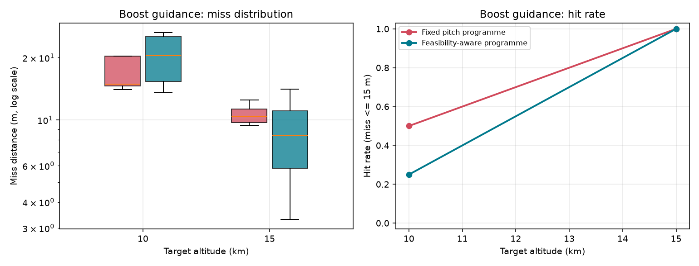
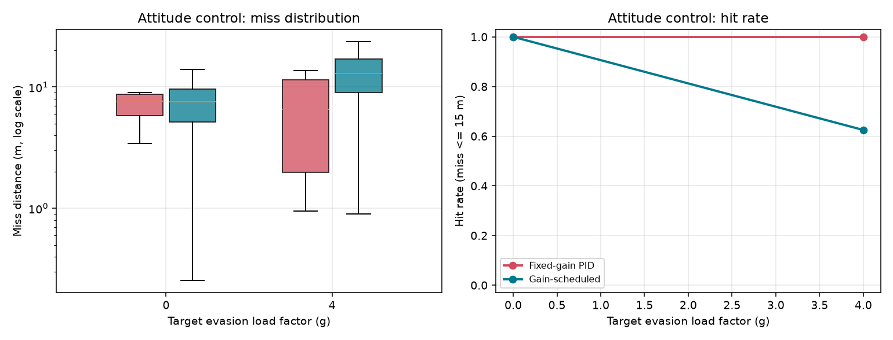
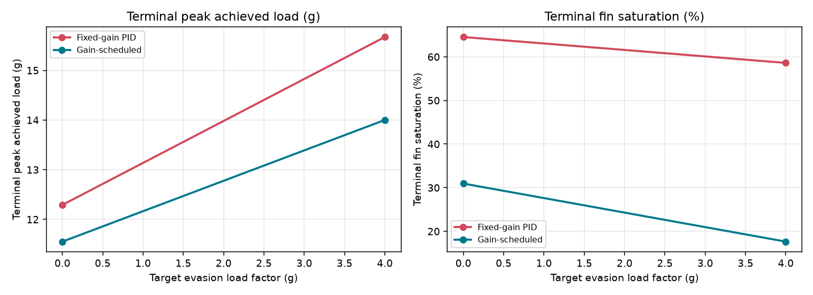

# 制导与控制算法对比实验报告

本报告由 `tools/guidance_comparison.py` 自动生成，全部数据来自 6DOF 端到端仿真，未经手工修改。

## 1. 实验设计

四个实验均采用**配对蒙特卡洛**：同一 `case_id` 在两种算法下使用完全相同的发射点/目标点散布、高度/马赫散布、导航与导引头随机种子以及目标机动相位，因此同一 case 的差异只来自被测环节的算法。每次只替换一个环节，其余三个环节固定为参考算法。

| 实验 | 被测环节 | 对比算法 | 固定配置 | 扫描参数 | 每档样本 |
| --- | --- | --- | --- | --- | --- |
| 助推段制导 | 助推段制导 | 常值俯仰速率程序 vs 升力可行域自适应程序 | 固定：Bezier 中制导 + ZEM/APN 末制导 + 调度三回路 | 目标高度 (km) 10, 15 | 4 |
| 中制导 | 中制导 | 预测拦截点直接中制导 vs Bezier 整形中制导 | 固定：自适应助推 + ZEM/APN 末制导 + 调度三回路 | 目标机动过载 (g) 0, 3 | 4 |
| 末制导 | 末制导 | 经典真比例导引 (PN) vs ZEM/APN 参考律 | 固定：自适应助推 + Bezier 中制导 + 调度三回路 | 目标机动过载 (g) 0, 2 | 4 |
| 姿态控制 | 姿态控制 | 固定增益三回路 vs 增益调度三回路 | 固定：自适应助推 + Bezier 中制导 + ZEM/APN 末制导 | 目标机动过载 (g) 0, 4 | 4 |

公共设置：基础随机种子 2026，命中判据为脱靶量 ≤ 15.0 m；发射点水平 CEP 500 m、目标水平 CEP 2000 m、目标高度 σ 500 m、目标马赫 σ 0.05；弹体、导航/导引头、交接逻辑与未被测环节全部相同。

## 2. 助推段制导对比结果

### 统计汇总

| 目标高度 (km) | 算法 | 有效样本 | 命中率 | 中位脱靶 (m) | P90 脱靶 (m) | 最大脱靶 (m) | 交接率 | 交接距离 (km) |
| --- | --- | --- | --- | --- | --- | --- | --- | --- |
| 10 | 常值俯仰速率程序 | 4 | 50.0% | 14.9 | 29.8 | 36 | 100 | 23.4 |
| 10 | 升力可行域自适应程序 | 4 | 25.0% | 20.4 | 26.0 | 26 | 100 | 23.4 |
| 15 | 常值俯仰速率程序 | 4 | 100.0% | 10.3 | 12.0 | 12 | 100 | 23.3 |
| 15 | 升力可行域自适应程序 | 4 | 100.0% | 8.4 | 12.9 | 14 | 100 | 23.3 |

### 全阶段指标（各扫描档平均）

| 目标高度 (km) | 算法 | 助推退出马赫 | 助推退出高度 (km) | 中制导峰值马赫 | 交接比能量 (MJ/kg) | 末制导峰值指令 (g) | 末制导峰值过载 (g) | 末制导舵面饱和 (%) | 交接方位角 (°) |
| --- | --- | --- | --- | --- | --- | --- | --- | --- | --- |
| 10 | 常值俯仰速率程序 | 2.16 | 6.3 | 9.44 | 4.53 | 40.0 | 18.3 | 7.7 | 7.27 |
| 10 | 升力可行域自适应程序 | 2.16 | 6.2 | 9.44 | 4.54 | 40.0 | 18.3 | 6.9 | 8.12 |
| 15 | 常值俯仰速率程序 | 2.16 | 6.3 | 9.44 | 4.81 | 40.0 | 14.0 | 18.1 | 4.96 |
| 15 | 升力可行域自适应程序 | 2.16 | 6.2 | 9.44 | 4.81 | 40.0 | 12.4 | 20.2 | 5.29 |

### 配对显著性检验（Wilcoxon 符号秩 + Bootstrap 中位数差 95% CI）

| 目标高度 (km) | 对比 | 配对数 | 中位差 (m) | 95% CI | p 值 | 结论 |
| --- | --- | --- | --- | --- | --- | --- |
| 10 | 常值俯仰速率程序 - 升力可行域自适应程序 | 4 | — | [—, —] | — | 未见显著差异 |
| 15 | 常值俯仰速率程序 - 升力可行域自适应程序 | 4 | — | [—, —] | — | 未见显著差异 |

## 3. 中制导对比结果

### 统计汇总

| 目标机动过载 (g) | 算法 | 有效样本 | 命中率 | 中位脱靶 (m) | P90 脱靶 (m) | 最大脱靶 (m) | 交接率 | 交接距离 (km) |
| --- | --- | --- | --- | --- | --- | --- | --- | --- |
| 0 | 预测拦截点直接中制导 | 24 | 79.2% | 10.8 | 17.4 | 28 | 100 | 23.3 |
| 0 | Bezier 整形中制导 | 24 | 100.0% | 7.6 | 10.5 | 14 | 100 | 23.3 |
| 3 | 预测拦截点直接中制导 | 24 | 45.8% | 16.9 | 28.7 | 40 | 100 | 23.4 |
| 3 | Bezier 整形中制导 | 24 | 75.0% | 11.1 | 16.9 | 25 | 100 | 23.3 |

### 全阶段指标（各扫描档平均）

| 目标机动过载 (g) | 算法 | 助推退出马赫 | 助推退出高度 (km) | 中制导峰值马赫 | 交接比能量 (MJ/kg) | 末制导峰值指令 (g) | 末制导峰值过载 (g) | 末制导舵面饱和 (%) | 交接方位角 (°) |
| --- | --- | --- | --- | --- | --- | --- | --- | --- | --- |
| 0 | 预测拦截点直接中制导 | 2.15 | 6.0 | 9.44 | 4.47 | 40.0 | 17.1 | 13.0 | 10.02 |
| 0 | Bezier 整形中制导 | 2.15 | 6.0 | 9.44 | 4.89 | 40.0 | 11.6 | 30.9 | 6.42 |
| 3 | 预测拦截点直接中制导 | 2.15 | 6.0 | 9.44 | 4.42 | 40.0 | 20.5 | 5.7 | 9.87 |
| 3 | Bezier 整形中制导 | 2.15 | 6.0 | 9.44 | 4.82 | 40.0 | 13.9 | 18.4 | 5.21 |

### 配对显著性检验（Wilcoxon 符号秩 + Bootstrap 中位数差 95% CI）

| 目标机动过载 (g) | 对比 | 配对数 | 中位差 (m) | 95% CI | p 值 | 结论 |
| --- | --- | --- | --- | --- | --- | --- |
| 0 | 预测拦截点直接中制导 - Bezier 整形中制导 | 24 | 2.9 | [2.0, 5.3] | 0.005 | 差异显著 |
| 3 | 预测拦截点直接中制导 - Bezier 整形中制导 | 24 | 6.3 | [1.7, 9.7] | 0.002 | 差异显著 |

## 4. 末制导对比结果

### 统计汇总

| 目标机动过载 (g) | 算法 | 有效样本 | 命中率 | 中位脱靶 (m) | P90 脱靶 (m) | 最大脱靶 (m) | 交接率 | 交接距离 (km) |
| --- | --- | --- | --- | --- | --- | --- | --- | --- |
| 0 | 经典真比例导引 (PN) | 24 | 70.8% | 10.4 | 29.6 | 33 | 100 | 23.3 |
| 0 | ZEM/APN 参考律 | 24 | 100.0% | 7.6 | 10.5 | 14 | 100 | 23.3 |
| 2 | 经典真比例导引 (PN) | 24 | 79.2% | 7.6 | 21.1 | 38 | 100 | 23.3 |
| 2 | ZEM/APN 参考律 | 24 | 87.5% | 9.6 | 16.8 | 34 | 100 | 23.3 |

### 全阶段指标（各扫描档平均）

| 目标机动过载 (g) | 算法 | 助推退出马赫 | 助推退出高度 (km) | 中制导峰值马赫 | 交接比能量 (MJ/kg) | 末制导峰值指令 (g) | 末制导峰值过载 (g) | 末制导舵面饱和 (%) | 交接方位角 (°) |
| --- | --- | --- | --- | --- | --- | --- | --- | --- | --- |
| 0 | 经典真比例导引 (PN) | 2.15 | 6.0 | 9.44 | 4.89 | 40.0 | 12.2 | 23.6 | 6.42 |
| 0 | ZEM/APN 参考律 | 2.15 | 6.0 | 9.44 | 4.89 | 40.0 | 11.6 | 30.9 | 6.42 |
| 2 | 经典真比例导引 (PN) | 2.15 | 6.0 | 9.44 | 4.83 | 40.0 | 13.4 | 19.5 | 4.68 |
| 2 | ZEM/APN 参考律 | 2.15 | 6.0 | 9.44 | 4.83 | 40.0 | 13.2 | 23.1 | 4.68 |

### 配对显著性检验（Wilcoxon 符号秩 + Bootstrap 中位数差 95% CI）

| 目标机动过载 (g) | 对比 | 配对数 | 中位差 (m) | 95% CI | p 值 | 结论 |
| --- | --- | --- | --- | --- | --- | --- |
| 0 | 经典真比例导引 (PN) - ZEM/APN 参考律 | 24 | 3.3 | [1.4, 8.6] | 0.001 | 差异显著 |
| 2 | 经典真比例导引 (PN) - ZEM/APN 参考律 | 24 | -2.2 | [-4.6, 2.3] | 0.439 | 未见显著差异 |

## 5. 姿态控制对比结果

### 统计汇总

| 目标机动过载 (g) | 算法 | 有效样本 | 命中率 | 中位脱靶 (m) | P90 脱靶 (m) | 最大脱靶 (m) | 交接率 | 交接距离 (km) |
| --- | --- | --- | --- | --- | --- | --- | --- | --- |
| 0 | 固定增益三回路 | 4 | 100.0% | 7.6 | 8.9 | 9 | 100 | 23.3 |
| 0 | 增益调度三回路 | 24 | 100.0% | 7.6 | 10.5 | 14 | 100 | 23.3 |
| 4 | 固定增益三回路 | 4 | 100.0% | 6.6 | 12.7 | 14 | 100 | 23.3 |
| 4 | 增益调度三回路 | 24 | 62.5% | 12.9 | 19.8 | 30 | 100 | 23.3 |

### 全阶段指标（各扫描档平均）

| 目标机动过载 (g) | 算法 | 助推退出马赫 | 助推退出高度 (km) | 中制导峰值马赫 | 交接比能量 (MJ/kg) | 末制导峰值指令 (g) | 末制导峰值过载 (g) | 末制导舵面饱和 (%) | 交接方位角 (°) |
| --- | --- | --- | --- | --- | --- | --- | --- | --- | --- |
| 0 | 固定增益三回路 | 2.14 | 6.3 | 9.44 | 4.89 | 40.0 | 12.3 | 64.5 | 5.98 |
| 0 | 增益调度三回路 | 2.15 | 6.0 | 9.44 | 4.89 | 40.0 | 11.6 | 30.9 | 6.42 |
| 4 | 固定增益三回路 | 2.14 | 6.3 | 9.44 | 4.80 | 40.0 | 15.7 | 58.6 | 4.08 |
| 4 | 增益调度三回路 | 2.15 | 6.0 | 9.44 | 4.82 | 40.0 | 14.0 | 17.6 | 5.37 |

### 配对显著性检验（Wilcoxon 符号秩 + Bootstrap 中位数差 95% CI）

| 目标机动过载 (g) | 对比 | 配对数 | 中位差 (m) | 95% CI | p 值 | 结论 |
| --- | --- | --- | --- | --- | --- | --- |
| 0 | 固定增益三回路 - 增益调度三回路 | 4 | — | [—, —] | — | 未见显著差异 |
| 4 | 固定增益三回路 - 增益调度三回路 | 4 | — | [—, —] | — | 未见显著差异 |

## 6. 结论

- **助推段制导**：常值俯仰速率程序 平均命中率 75.0%，升力可行域自适应程序 为 62.5%；平均中位脱靶量 12.6 m 与 14.4 m。配对中位差（常值俯仰速率程序 − 升力可行域自适应程序）范围 — ~ — m，正值为前者脱靶量更大；在 0/2 个扫描档上配对差异达到 p < 0.05。助推退出平均高度 6.3 / 6.2 km，马赫 2.16 / 2.16。
- **中制导**：预测拦截点直接中制导 平均命中率 62.5%，Bezier 整形中制导 为 87.5%；平均中位脱靶量 13.8 m 与 9.3 m。配对中位差（预测拦截点直接中制导 − Bezier 整形中制导）范围 2.9 ~ 6.3 m，正值为前者脱靶量更大；在 2/2 个扫描档上配对差异达到 p < 0.05。交接比能量 4.45 / 4.86 MJ/kg，交接方位角 9.95 / 5.81°。
- **末制导**：经典真比例导引 (PN) 平均命中率 75.0%，ZEM/APN 参考律 为 93.8%；平均中位脱靶量 9.0 m 与 8.6 m。配对中位差（经典真比例导引 (PN) − ZEM/APN 参考律）范围 -2.2 ~ 3.3 m，正值为前者脱靶量更大；在 1/2 个扫描档上配对差异达到 p < 0.05。末制导平均峰值指令 40.0 / 40.0 g。
- **姿态控制**：固定增益三回路 平均命中率 100.0%，增益调度三回路 为 81.2%；平均中位脱靶量 7.1 m 与 10.2 m。配对中位差（固定增益三回路 − 增益调度三回路）范围 — ~ — m，正值为前者脱靶量更大；在 0/2 个扫描档上配对差异达到 p < 0.05。末制导平均舵面饱和率 61.6% / 24.3%，峰值实际过载 14.0 / 12.8 g。
- 四个实验中的“差异显著”仅表示在该模型、该样本量与配对设计下统计可分辨，不构成对其他弹体/传感器配置的外推结论。

## 7. 方法与可复现性

- 仿真：6DOF 刚体 + 四元数姿态，RK4 变步长积分，制导 5 ms / 控制 5 ms / 导引头与导航按各自周期零阶保持。
- 对比公平性：未被测环节完全固定；同一实验内两种算法共享同一时间对齐、导引头几何、重力补偿、FOV 保护、指令平滑与过载限幅管线。
- 控制对比说明：两种自动驾驶仪共用同一参考调节器、时延预测、内外环增益基准值、抗积分饱和与舵面限幅；差异仅为增益调度与法向过载环。
- 统计：命中率为脱靶量 ≤ 15.0 m 的比例；配对检验对同一 case 的脱靶量做 Wilcoxon 符号秩检验，Bootstrap（2000 次）给出中位数差 95% 置信区间。
- 复现命令：`python tools/guidance_comparison.py --cases 4 --seed 2026`

## 8. 适用边界

弹体几何、质量/惯量与气动/推进参数为公开资料的工程外推（见仓库 README 免责声明），实验结论只对该模型成立，不代表任何实装系统性能。

## 图表

