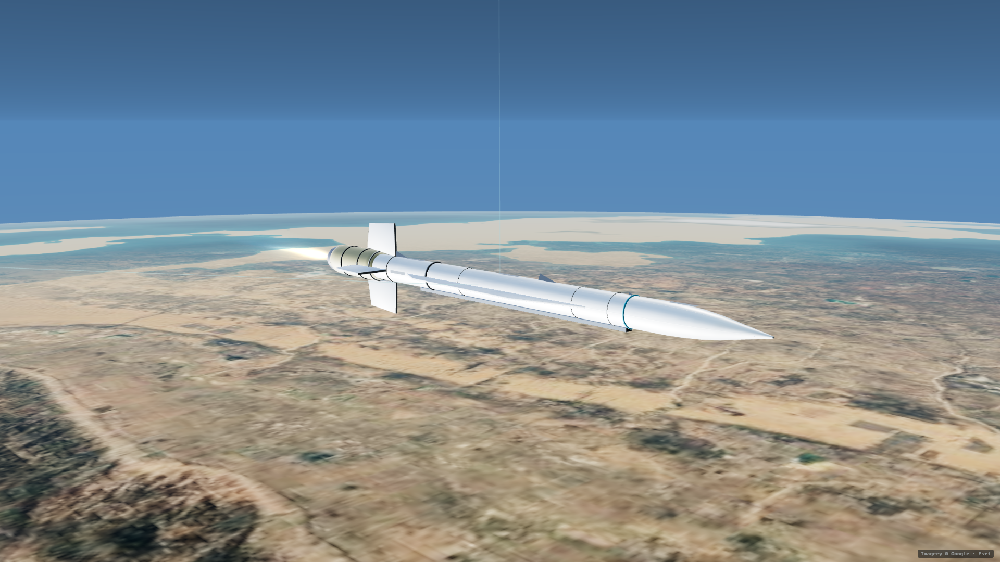

# Interceptor Vision · 拦截弹视景

独立的拦截弹三维视景 Demo：Blender 负责模型、纹理与 HDRI，Three.js 负责实时渲染与交互，GitHub Pages 负责静态部署。它与参考工程 `missile_interception` 的制导、控制、弹道算法完全解耦，仅复用其"专业航空航天软件"的界面与渲染思想。

**该应用现在是原平台“进入三维探索”的正式主视景页**：首页/导航中的探索入口直接指向本应用；原数据驱动探索器的任务面板、遥测、时间线、图表与相机功能已全部融合进本页（旧版 `/explore-legacy` 路由已在 v0.3.0 清理移除）。

在线演示：<https://paoshou-china.github.io/missile-interception/interceptor-vision/>



## 功能

- **打击指标前置**：任务卡以 34 px Hero 显示脱靶量（当前标称基线 **1.48 m** @ `680.47 s`，近炸引信 $P_k = 99.5\%$），下方 2×2 给出拦截时刻、交会速度、锁定距离、拦截高度，顶栏常驻“脱靶量”琥珀色标签；全部由 payload 现算。
- **高保真 3D 载具与 GLSL 物理场**：
  - **拦截弹**（`Missile.tsx`）：实景巡航弹体叠加双侧二维斜板超燃进气道（含 Unstart 喘振发光）、背部整流脊、四片助推稳定翼与级间卡箍（T+13.0 s 触发助推级分离翻滚），以及自定义 GLSL 体积马赫环尾焰（随助推/超燃/Unstart 动态切换）；
  - **F-35A 目标机**（`TargetTrack.tsx`）：`15.7 m × 10.7 m` 棱线隐身机身、金色 ITO 气泡座舱盖、雕刻式 DSI 进气道与鼓包、蓝宝石 EOTS 棱镜、15 片锯齿 F135 矢量喷口 + GLSL 加力尾焰及实时 3D 红外诱饵弹抛射；
  - **X 光物理场透视模式**（`AeroPhysicsOverlay.tsx`，快捷键 `X`）：基于遥测 `q_dot`、`T_w` 与气动力实时渲染随马赫数/攻角变化的自定义 GLSL 脱体激波锥、黑体辐射头罩热力着色、3D 升力/阻力/推力/尾舵 NMP 反向直接力矢量与动态 CG/CP 静稳定裕度标记。
- **双模导引头抗诱饵监控与 B-Plane 归因**（`SeekerOverlay.tsx`）：四联实测传感器画布——X 波段脉冲多普勒 R-D 热图（`48×28` 离屏 `ImageData`）、MWIR 焦平面热成像（`128×84` 离屏 `ImageData`）、360° 隐身 RCS 极坐标（含 `±30°` 视场与诱饵/箔条波门剔除状态 `FLARE GATED` / `CHAFF REJECTED`）及 B-Plane 杀伤盒与脱靶误差归因瀑布图；动态传感器重绘解耦至 **25 Hz**（DPR 上限 `1.25`），静态 B-Plane 面板独立渲染，不抢占 60 FPS 主场景。
- **语义化事件时间轴与 `0.1×` 末段子弹时间**（`Transport.tsx`）：播放条自动标注助推分离、最大动压、Unstart、诱饵抛射、交接与拦截锚点，一键跳转并切入 `0.1×` 末段慢放，支持 `?t=...&view=...` 深度链接一键分享；播放期间通过 `useRef` + Zustand `subscribe` + `rAF` 更新 DOM，实现零 React 重渲染。
- **实景巡航视景与弹道叠层**：背景按遥测经纬度实时流式加载卫星影像（Esri 为主、Google 兜底），完整飞行弹道以屏幕等宽光带绘制（空中轨迹 + 地面投影 + 流动光点 + 关键节点标记）。
- **末段 6-DoF 实时弹道解算与校验**：左栏“弹道解算”从记录交班状态实时重算末段（支持可调目标几何/机动与导航比，默认刚体 6-DoF 闭环 + 可切换 3-DoF）；`node scripts/validate_aero.mjs`（**28/28**）、`node scripts/validate_6dof.mjs`（**12/12**）与 `npm run build` 全部通过，详见 [docs/VALIDATION.md](docs/VALIDATION.md)。
- **任务与遥测回放**：载入原平台由 `telemetry.npz` 生成的 **1,509 帧**验证遥测（源自 53,673×152 `float64` 数据），包含多尺度 8 机位、11+ 组交互式遥测曲线、中英文切换、三档画质（Performance / Balanced / Cinematic）与 ≤900 px 窄屏抽屉适配。
- **遥测图表**：11 组曲线（高度、速度、马赫、动压、过载、斜距、导引头离轴角、四路舵偏、三轴角速率、攻角/侧滑角、DACS 侧向过载），带时间轴刻度，可一键导出 CSV（含 α/β 与 DACS 列），点击图表可跳转时间，Esc 关闭。
- **方法与数据**：顶栏 ⓘ 打开数据溯源面板——源仓库/commit/sha256、6-DoF 引擎与 10 ms 采样、11 项校验结果、可复现性与散布配置、观测量定义，以及本地 ENU 投影、抛物线下沉、影像来源等近似说明与免责声明；可复制当前时刻深链（`?t=&view=`）。
- **多尺度视角**：宏观（地表与远景）、中观（整弹 + 卫星地面）、微观（尾舵/喷管/边条）、尾追、俯视、目标（骑在目标上的跟踪特写，末端弹目同框）、电影（预设相机动画）、自由（轨道控制）。
- **真实环境**：HDRI 环境光照、大气霞光、日侧地平线暖带与高空卷云、大气层蓝色边缘、太阳/月亮/星空、昼/昏/夜三套预设；海面有向阳细碎反光，近地背景为 z10 卫星影像、公里级地表细节噪声与程序化远景的分层混合，远景按真实大气透视淡入同色霞霭。
- **影调**：半哑光漆面 + clearcoat 弹体、反向冷色轮廓光、暖冷双色发动机辉光；Cinematic 档启用暗角与 Bloom，Balanced 用零后期代价的精灵辉光保持 60 FPS。
- **三档画质**：Performance / Balanced / Cinematic，控制 DPR（上限 1.0 / 1.25 / 1.25 并自适应升降）、阴影刷新、云层数量与后期（Cinematic 才启用暗角与 Bloom）；面板不再使用实时背景模糊。
- **窄屏可用**：≤900 px 时左右面板变为互斥抽屉（默认收起、带遮罩），相机按画面宽高比自动拉远，竖屏也能完整看到弹体。
- **专业界面**：左侧任务与视角、右侧实时遥测与事件、底部数据时间线；面板折叠、中英文切换、图表与离线影像。
- **资产流水线**：全部模型/纹理/HDRI 由 Blender Python 脚本自动生成，可重复构建；GLB 提供三级 LOD。弹体外形参考公开的 SM-3 Block IB/IIA 三视图（尖锥头罩、收线边条、四片尾舵、MK72 式助推级）。

## 快速开始

```bash
cd interceptor-vision
npm ci
npm run dev        # 开发服务器
npm run build      # 生产构建
npm run preview -- --port 4176
```

浏览器打开 `http://127.0.0.1:4176/`。首次加载约 1.1 MB（LOD0 + 当日 HDRI；卫星瓦片按当前位置在后台加载，远端 LOD 在首帧后预热）。

### 快捷键

| 按键 | 功能 |
| --- | --- |
| Space | 播放/暂停 |
| X | 切换 3D 激波锥 / 黑体热力着色 / X 光受力矢量与 CG·CP 标记 |
| S | 高清截图（PNG） |
| F | 全屏 |
| H | 折叠/展开两侧面板 |
| Esc | 关闭图表 / 导引头监控 / 离线影像画廊 |

所有预设视角（宏观/中观/微观/尾追/俯视/目标）均可拖拽旋转、滚轮缩放、双击复位；目标视角跟随目标飞行，末端自动把镜头重心移到弹目中点；自由视角使用轨道控制器，电影视角保持导演路径。

## Blender 资产管线

Blender 版本：**4.2.12 LTS**（脚本使用 `bpy` 4.2 API）。详细步骤见 [blender/README.md](blender/README.md)。

```bash
# 生成拦截弹 GLB（含三级 LOD 与嵌入纹理）与 .blend
blender -b -P blender/scripts/build_missile.py

# 生成地形、云层纹理与三套 HDRI
blender -b -P blender/scripts/build_environment.py

# 离线静帧（昼/昏/夜 × 宏/中/微）
blender -b blender/interceptor.blend -P blender/scripts/render_stills.py

# 离线飞行动画（EEVEE → H.264）
blender -b blender/interceptor.blend -P blender/scripts/render_flyby.py

# 重新生成离线画廊清单
node scripts/gallery_manifest.mjs
```

产物：

- `blender/interceptor.blend`：可编辑的原始工程。
- `blender/environment.blend`：环境资产生成工程。
- `public/assets/interceptor-lod{0,1,2}.glb`：实时渲染资产，嵌入面板法线/粗糙度纹理。
- `public/assets/env-{day,dusk,night}.hdr`：Radiance RGBE 环境贴图。
- `public/assets/terrain-*.jpg`、`cloud-*.png`：地表与云层纹理。
- `public/renders/`：Cycles 静帧、EEVEE 飞行动画与 `manifest.json`。

## 架构

```
interceptor-vision/
├── blender/
│   ├── scripts/build_missile.py       # 程序化弹体、翼面、尾舵、材质、LOD、GLB 导出
│   ├── scripts/build_environment.py   # 地形/云纹理 + Nishita 天空 HDRI
│   ├── scripts/render_stills.py       # Cycles 离线静帧
│   ├── scripts/render_flyby.py        # EEVEE 飞行动画
│   ├── interceptor.blend              # 原始工程
│   └── environment.blend
├── public/
│   ├── assets/                        # GLB、HDRI、纹理
│   ├── data/scenario.json             # 原平台的 1509 帧验证遥测（1.68 MB，float64 .npz 转换）
│   └── renders/                       # 离线成品 + manifest.json
├── src/
│   ├── scene/                         # 场景、环境、卫星瓦片、模型、相机、遥测时钟
│   ├── data/                          # 遥测加载、插值、时间轴辅助
│   ├── components/                    # 顶栏、面板、任务、遥测、图表、时间线、画廊
│   ├── state.ts / i18n.ts / styles.css
│   └── App.tsx
└── docs/                              # 截图、性能与部署记录
```

渲染与数据分离：`src/scene/Environment.tsx` 只负责环境与光照，`src/scene/Missile.tsx` 只负责模型与尾焰，UI 状态集中在 `src/state.ts`，Blender 脚本彼此独立。

## 画质档位

| 档位 | DPR | 阴影 | 云层 | 地形细分 | 后期 |
| --- | --- | --- | --- | --- | --- |
| Performance | 1.0 | 关闭 | 无 | 64 | 关闭 |
| Balanced | 1–1.25 | 1024 | 无 | 96 | 原生 MSAA |
| Cinematic | 1–1.25 | 2048 | 1 层 | 128 | 暗角 + 弱 Bloom |

纹理压缩：GLB 纹理由 Blender 以 WebP（质量 90）嵌入；地形/云层使用 WebP 副本；HDRI 降为 512×256。几何使用三级 LOD（约 26 m / 160 m 距离切换），LOD1/LOD2 在首帧后预热，不阻塞首屏。如需进一步压缩可对 GLB 运行 `gltf-transform` 的 Draco/Meshopt 优化。

## 性能（实测）

| 指标 | 结果 |
| --- | --- |
| 首帧就绪 | 0.7 s（本地 preview，1920×1080 无头 Edge） |
| 首屏关键资源 | LOD0 0.84 MB，HDRI 0.51 MB，地形/云 WebP 约 0.37 MB |
| 延迟加载 | LOD1 0.43 MB、LOD2 0.21 MB 在首帧后预热 |
| 遥测数据 | `scenario.json` 1.0 MB（gzip 后约 0.2 MB），首帧后 0.9 s 后台加载，不阻塞画面 |
| 卫星影像 | 按当前经纬度流式请求：8×8 张 z10 瓦片（约 313 km 见方，约 153 m/px）约 0.3–0.6 MB，按需缓存，Google 失败时自动切换 Esri |
| 帧率（Intel UHD，1920×1080） | Performance 60.0 / Balanced 60.0 FPS；Cinematic 46.6–60.1 FPS（Bloom 随负载波动）；20×/60× 连续播放无 >50 ms 长任务 |
| 控制台错误 | 0 |

详见 [docs/PERFORMANCE.md](docs/PERFORMANCE.md)。

## 截图

昼 / 昏 / 夜 × 宏 / 中 / 微共 9 张运行截图与 3 张 UI 截图位于 `docs/screenshots/`；Blender 离线静帧位于 `public/renders/`。

## 部署

静态站点，`base` 为相对路径，可部署在任意子路径。当前通过 `.github/workflows/aerospace-vision-pages.yml` 构建并复制到 `dist/interceptor-vision/`。详见 [docs/DEPLOY.md](docs/DEPLOY.md)。

## 许可与资产来源

拦截弹模型、地形/云纹理、HDRI 与离线渲染均由本工程脚本原创生成，不包含第三方模型或贴图。参考工程仅用于界面、渲染架构与部署方式的借鉴。
